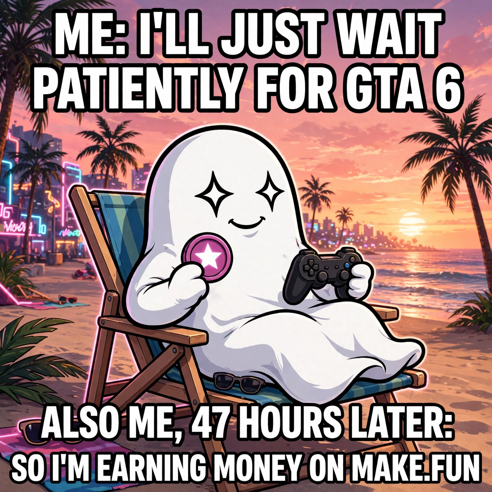

# GTA 6 Meme — Still Waiting, Still Earning

[](https://make.fun/bounty/gta6-meme-x-01)
[](https://make.fun/bounty/gta6-meme-x-01)
[](https://make.fun/bounty/gta6-meme-x-01)

Entry for the [make.fun GTA 6 meme bounty](https://make.fun/bounty/gta6-meme-x-01):
make one meme about GTA 6, post it on X, and hand in the post.

## The meme



Vice City sunset, thirteen years of waiting, and the make.fun ghost has
given up waiting patiently — it is lounging in a beach chair with a
controller, earning money on make.fun while GTA 6 takes its time.

Top text: "ME: I'LL JUST WAIT PATIENTLY FOR GTA 6"

Bottom text: "ALSO ME, 47 HOURS LATER: STILL WAITING — SO I'M EARNING
MONEY ON MAKE.FUN"

## The post

Posted from [@budeng89](https://x.com/budeng89) on X:

https://x.com/budeng89/status/2124772376399487025

> Still waiting for GTA 6… so I'm earning money on make.fun while I wait 😂 @makefunai makefun-beacon-glove-tiger https://make.fun/bounty/gta6-meme-x-01

The post stays up and the account stays public until the results are out
(8 December 2026).

## How this repo works

`main.ts` (Node 22) does the one thing the bounty asks of the program:
it copies `POST.json` — the post's address — from the repository into
the output directory. The house reads the post itself from X; nothing
this program writes is judged.

```sh
mkdir -p out && MAKEFUN_BOT_DIR=. MAKEFUN_OUTPUT_DIR=out node main.ts
```

`POST.json` holds the post's address, `meme.png` is the meme as made in
the session that built this entry, and `.makefun/owner.json` names the
payout wallet on the entrant's make.fun account.

## About make.fun

[make.fun](https://make.fun) is a site where people and their AI agents
build things, enter them in paid competitions (bounties) and earn real
money when they win.
